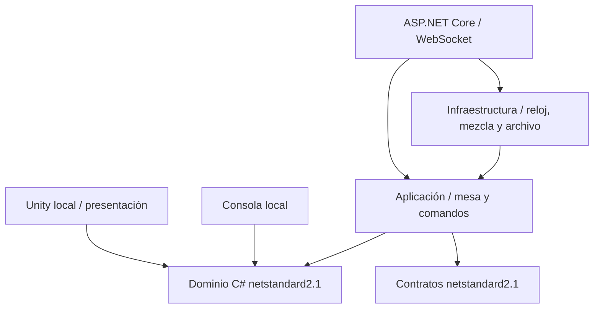

# Decisiones y dependencias

El cliente gráfico local actual es `Domino.Desktop` (ASP.NET Core + Three.js), que reutiliza `Domino.Application/PracticeMatch` y el mismo `Domino.Domain`. La entrada, cámara, distribución, navegación y preferencias están separadas en módulos; véase [EXPERIENCIA_GRAFICA.md](EXPERIENCIA_GRAFICA.md). El cliente WebSocket experimental y Unity siguen siendo adaptadores independientes, sin conexión gráfica en línea terminada. La cookie `patio-practice-v2-PUERTO` separa las instancias locales; se reconoce la cookie anterior cuando su sesión aún está en memoria.

1. Monolito modular: dominio sin Unity, E/S, tiempo ni aleatoriedad. Recibe reparto completo ya mezclado. La aplicación recibe reloj, repositorio y mezclador. La autoridad local Unity es exclusiva del modo offline; no es un cliente multijugador con autoridad.
2. Unity 6.3 LTS, URP 17.3.0 e Input System 1.17.0 como base inicial. El primer adaptador usa IMGUI para toque/clic; migrar a UI/Input Actions tras validar editor. OpenXR y XR Interaction Toolkit se dejan para hito 4; no se agregan paquetes ni se promete VR funcional sin elegir visor y verificar compatibilidad.
3. Reglas inmutables `patio-rd/1`. Solo meta, bono 0/25/30 y tiempo tienen configuración actualmente. No se finge soporte de las demás variantes; no hay API para solicitarlas. El servidor bloquea sus reglas predeterminadas antes de aceptar. La UI local muestra resumen y pide aceptación.
4. Dominio y contratos usan paquetes locales UPM, no copias manuales. Motor compilado en .NET Standard 2.1; backend en .NET 10. No se usaron dependencias NuGet externas.
5. Servidor procesa por `SemaphoreSlim` por mesa. Persistencia local de reparto y comandos con renombrado atómico y escritura forzada antes de confirmar. Replay determinista reconstruye mano, puntuación y bonos. No admite múltiples instancias del servidor escribiendo la misma carpeta. Repositorio PostgreSQL necesitará transacción de revisión y comando antes de pasar a varias réplicas.
6. Tokens de asiento de 256 bits; se persisten solo hashes SHA-256. Son credenciales de invitado del prototipo, sin cuentas ni renovación. La mesa no devuelve secretos del rival. Máximo 4 KB por mensaje y 10 comandos/s por conexión; HTTP 120 solicitudes/min por IP. Faltan cuotas de conexiones/mesas y límites de almacenamiento para producción.
7. El orden en la mano es presentación local. Geometría de cadena separada: 28 posiciones de una cuadrícula serpenteante 7×4, separación mayor que el tamaño de cada ficha. No son ramas de dobles. Falta enlazar giros visualmente, destacar puntas en el mundo y verificar límites con imágenes de Unity.

Fuentes oficiales consultadas el 2 de noviembre de 2026:

- [Soporte Unity 6](https://unity.com/releases/unity-6/support): Unity 6.3 LTS con soporte de largo plazo.
- [Release 6000.3.0f1](https://unity.com/releases/editor/whats-new/6000.3.0f1): versión base existente, no afirmación de último parche.
- [Changelog oficial URP](https://github.com/Unity-Technologies/Graphics/blob/master/Packages/com.unity.render-pipelines.universal/CHANGELOG.md): línea 17.3 para 6000.3.
- [Release 6000.3.1f1](https://unity.com/pt/releases/editor/whats-new/6000.3.1f1): Input System 1.17.0 en la línea 6000.3. La resolución efectiva se comprobará en editor.
- [Perfiles .NET de Unity](https://docs.unity.com/en-us/engine/6000.5/manual/scripting/environment-and-tools/overview-of-dot-net-in-unity/dotnet-profile-support): .NET Standard 2.1 como superficie compatible. Falta confirmar la compilación efectiva de todas las APIs del cliente en editor 6000.3.
